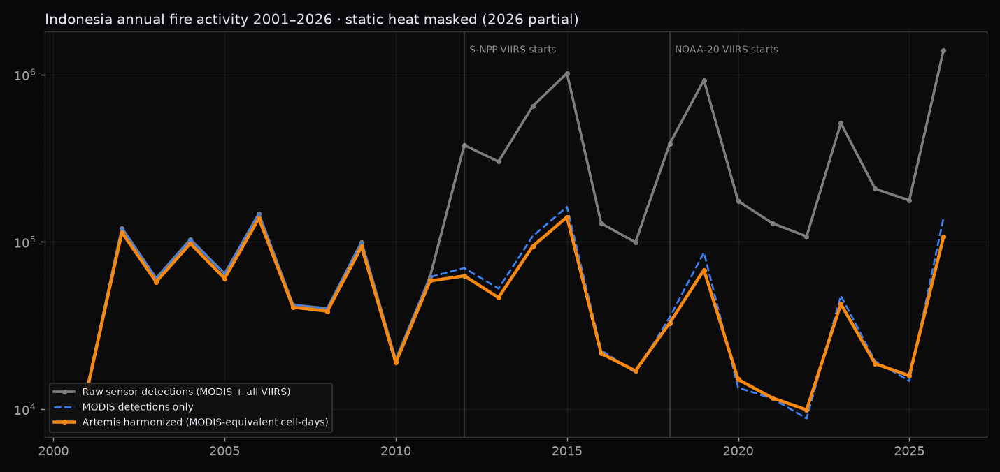

# ARTEMIS: harmonized satellite fire calendar for Indonesia

> NASA Space Apps Challenge 2026 · Team ITS Surabaya

Twenty-six years of NASA fire detections over Indonesia, from MODIS (2000→) and VIIRS (2012→), put on one comparable scale. From that record Artemis builds a month-by-month burning calendar, flags anomalous months and suspicious burn patterns, and turns any hotspot into an action.

**Quick path for judges:**
1. **Landing** `/`: live telemetry, raw vs harmonized chart.
2. **Dashboard** `/dashboard`:
   - pick Central Kalimantan;
   - open Sep 2015 in the calendar;
   - download the CSV;
   - click a hexagon or live hotspot;
   - open the Impact Hub.
3. **Audit** `/audit`: run demo plot B, then download the due diligence statement.

## The problem

Indonesia's peat and forest fires (2015 and 2019 each burned well over a million hectares) are monitored mostly through 24–48 h live hotspot feeds. Those feeds answer "where is it burning now", but not "is this month unusual?", "does this place burn every few years?" or "what can I do about this hotspot?".

The long record exists, but it can't be compared over time. When VIIRS arrived in 2012, its 375 m pixels began recording about four times as many fire pixels as 1 km MODIS for the same fires. A naive count therefore shows a fire explosion in 2012 that never happened.

## What Artemis does, by challenge objective

The objectives below are paraphrased from our reading of the challenge brief.

| Objective | How Artemis meets it | Where |
|---|---|---|
| Combine MODIS and VIIRS into one consistent long-term record | Per-month VIIRS→MODIS calibration on fire cell-days; S-NPP and NOAA-20 harmonized, NOAA-21 live | `pipeline/harmonize.py`, calendar "Artemis harmonized" |
| Show the 2012 sensor jump and its correction | Raw vs harmonized toggle on the calendar; validation chart below | Calendar toggle, landing preview |
| Burning-activity calendar by region and month | Year × month matrix 2000–2026 for Indonesia and 5 fire provinces, or any lat/long radius or drawn polygon | `/dashboard` |
| Anomalies against a long baseline | Z = (month − median) / IQR, 2001–2025 baseline, partial current month projected | Calendar anomaly panel |
| Remove non-fire heat | Static mask: FIRMS volcano / static / offshore types plus persistent cells (18,251 sources, 428,579 detections) | Mask toggle, map overlay |
| Spatial detail | H3 cells of ~5 km² (archive), pixel-footprint ellipses at zoom ≥ 9 | Map |
| Data access | CSV export of monthly analytics and detection-level hotspots for any area and period | Calendar "CSV" |
| Accessible design | Colorblind-safe ramps (Viridis, Cividis, YlOrRd); keyboard calendar; table view; AA contrast | Control bar |

**Beyond the brief:**
- A forensic signature score per cell.
- A 4-branch Impact Hub, opened from any hotspot.
- An EUDR zero-burn audit for any plot.

## Harmonization method

1. **Clip.** Detections are clipped to Indonesia using geoBoundaries province polygons (7.79 M detections, Nov 2000 – Nov 2026).
2. **Grid.** Each detection is gridded to H3 resolution 8 (~0.74 km²). The unit is the **fire cell-day**: one cell × one day with ≥ 1 detection, per sensor. This removes most of the extra pixels VIIRS records for a single fire.
3. **Calibrate.** For each VIIRS platform and calendar month, α = median of monthly MODIS / VIIRS cell-day ratios over the overlap years. Provinces get their own α only when they have enough overlap data (≥ 30 cell-days per sensor) and the value stays within 0.5–2× the national α.
4. **Harmonize.** Before 2012 the series is MODIS alone; after that it is the mean of MODIS, α·S-NPP and α·NOAA-20, for every sensor covering ≥ 50% of the month.

| Platform | National pooled α | Monthly α range | Fit (log R²) | Median abs. error |
|---|---|---|---|---|
| VIIRS Suomi-NPP | 0.274 | ≈ 0.21–0.31 | 0.976 (167 months) | 9.6% |
| VIIRS NOAA-20 | 0.253 | ≈ 0.21–0.31 | 0.968 (93 months) | 12.0% |



Across 2001–2025, raw detection counts jump about 4.9× after 2012. The harmonized series has no step at 2012.

The full method is in [`pipeline/README.md`](pipeline/README.md).

## Anthropogenic thermal signature (forensic score)

A transparent, **rule-based score** (0–100) for every ~5 km² cell with at least 3 active days since 2001 (168,595 cells), plus its national percentile.

| Feature | Weight | What it measures |
|---|---|---|
| Multi-year recurrence | 0.35 | Years with burning, and the share of gaps between burn years lasting 3–5 years |
| Off-season burning | 0.30 | Detections in the province's low-fire months (drought-anomaly months count half) |
| Geometric regularity | 0.20 | How line-like same-day VIIRS clusters are |
| Afternoon timing | 0.15 | Afternoon-overpass share, ranked within the province |

Score quantiles: median 38, p90 53, p99 62. The Impact Hub evidence dossier unlocks for the top 10% (percentile ≥ 90).

**Limitations:**
- This is **not a trained model and not a probability**. The weights are hand-set.
- The planned validation compares post-fire NDVI and forest-loss trajectories; it is shown as "Planned" in the inspector and is not in this build.
- VIIRS scan geometry can make small clusters look linear.
- Peat fires are mostly human-ignited but burn in the dry season, so a low score does not mean "natural".
- The score flags patterns for field checks. It never identifies who started a fire.

## What is real and what is simulated

| Real data | Simulated, and tagged SIMULATED or DEMO in the UI |
|---|---|
| 2000–2026 archive, calendar, anomalies, mask, hexes, forensic scores | Escrow pledges and the QRIS/CSR payment flow: no payment is made |
| Live NASA FIRMS hotspots (MODIS, NOAA-20, NOAA-21) | SMS / WhatsApp patrol bot and photo labels (stored in the browser only) |
| Next VIIRS overpass: CelesTrak orbit data propagated with SGP4 | WhatsApp haze-alert broadcast: preview only, nothing is sent |
| Downwind cone from live OpenWeatherMap wind | P2P logistics board (stored in the browser only) |
| Schools and clinics in the cone from OpenStreetMap | Demo plot **names** in `/audit`; their coordinates and verdicts are real |
| EUDR verdicts, burn-rate statistics and dossiers computed from the archive | |

The demo audit plots, chosen from the processed data:
- **Plot A:** square centred at 4.630°N, 96.860°E (±0.006°), Central Aceh. Its archive cell burned only in 2018, so it **passes**.
- **Plot B:** −3.222…−3.205°N, 112.664…112.690°E, Central Kalimantan. 60 detections since 2021 and a 3.0-year mean burn interval, so it is **flagged**.

## Data sources and attribution

| Source | Used for | Access |
|---|---|---|
| NASA FIRMS: MODIS C6.1, VIIRS S-NPP / NOAA-20 / NOAA-21 | Archive and live hotspots | Server proxy `/api/firms` (MAP_KEY on the server) |
| CelesTrak | NOAA-20 / NOAA-21 orbit data (TLEs) | Server proxy `/api/tle`, cached 6 h |
| OpenWeatherMap | Current wind, humidity, temperature | Server proxy `/api/weather` |
| NewsData.io | English wildfire news (top-priority domains, duplicates and aggregators removed) on the landing page | Server proxy `/api/news` |
| OpenStreetMap via Overpass API | Schools and health facilities in the haze cone | Browser, public endpoint |
| OpenStreetMap Nominatim | Place names for hotspots | Browser, public endpoint |
| CARTO basemaps | Dark map tiles | Browser |
| Every.org | Global wildfire nonprofits | Browser (public partner key) |
| geoBoundaries (CC BY 4.0) | Province polygons in the pipeline | Pipeline only |

Map data © OpenStreetMap contributors, © CARTO. Fire data courtesy of NASA FIRMS (LANCE / EOSDIS).

## Running locally

```bash
npm install
cp .env.example .env    # fill in your own keys
npm run dev             # http://localhost:5173
```

Checks: `npm run typecheck`, `npm run lint`, `npm run build`.

The processed archive ships in `public/data/` (about 126 MB), so the pipeline is only needed to rebuild it.

### Rebuilding the archive

```bash
python -m pip install -r pipeline/requirements.txt
python -I pipeline/fetch_archive.py   # ~1 GB raw FIRMS download, resumable
python -I pipeline/harmonize.py       # clip, grid, mask, calibrate, anomalies
python -I pipeline/export.py          # write public/data/
python -I pipeline/forensics.py       # forensic signature tiles
```

Raw and intermediate files go to `%LOCALAPPDATA%/artemis-pipeline/`. Override with `ARTEMIS_RAW_DIR` / `ARTEMIS_WORK_DIR`.

## Environment variables

Server-side variables are read only by the `/api/*` functions (and the Vite dev server). They never reach the browser.

| Variable | Side | Required | Purpose |
|---|---|---|---|
| `FIRMS_API_KEY` | Server | Yes | NASA FIRMS MAP_KEY |
| `OPENWEATHER_API_KEY` | Server | Yes | OpenWeatherMap current weather |
| `NEWSDATA_API_KEY` | Server | No | NewsData.io (the legacy name `VITE_NEWSDATA_API_KEY` is still read server-side) |
| `VITE_CARTO_API_KEY` | Browser | No | CARTO basemap key |
| `VITE_EVERY_ORG_API_KEY` | Browser | No | Every.org public partner key |
| `VITE_DONATION_DISCOVERY_URL` | Browser | No | Optional Python discovery service (`services/donation-discovery`) |

## Deploying to Vercel

`vercel.json` serves the SPA (every app route falls back to `index.html`), the static `/data` archive with cache headers, and four functions: `api/firms`, `api/weather`, `api/tle` and `api/news`.

**Recommended: GitHub + Vercel Git integration.** The static archive is about 126 MB, over the 100 MB limit for CLI uploads on the Hobby plan; deploying from a Git repository has no such limit.

1. Push this repository to GitHub (every file in the repo is under GitHub's 100 MB per-file limit).
2. In Vercel: **Add New → Project → Import** the repository. Framework preset: **Vite** (detected). Build command `npm run build`, output `dist` (both also set in `vercel.json`).
3. **Settings → Environment Variables** (Production and Preview): add the variables from the table above. `FIRMS_API_KEY` and `OPENWEATHER_API_KEY` are required for the live map and weather; the others are optional.
4. Deploy. Every push to `main` redeploys; pull requests get preview URLs.
5. After the first deploy, set the absolute share-card URL in `index.html` (`og:image`, `twitter:image`) to `https://<your-domain>/og-image.png`.

Alternatives to the Git route: the Pro plan, or shrinking the archive under 100 MB (for example by gzipping the `hex/` and `forensics/` JSON as the point files already are) and deploying with `vercel --prod`.

## Project structure

```
api/                  Vercel functions (thin wrappers)
server/handlers.ts    Proxy logic shared by the functions and the Vite dev server
pipeline/             Python archive pipeline and method notes
public/data/          Processed archive (calendar, hex, points, forensics, static)
src/pages/            Landing, Dashboard, Impact, Audit
src/components/       Map, calendar, inspector, impact hub, landing sections
src/lib/              AOI geometry, calendar data, audit, dossier, haze cone, exports
src/data/             Typed loaders for the archive and APIs
```

## Limitations

- Harmonization is a statistical calibration of counts, not a re-detection. α captures the average sensitivity difference per calendar month, not per fire.
- MODIS Terra's orbit has drifted since 2020. S-NPP and NOAA-20 data after July 2026 are near-real-time products that FIRMS later reprocesses.
- Satellites miss fires under persistent cloud. The inspector warns when nearby fires seen yesterday are missing today.
- Detection positions carry pixel-size uncertainty: 375 m (VIIRS) or 1 km (MODIS) at nadir, and more toward the swath edge.
- The haze cone is straight-line advection from the current surface wind, not a dispersion model.
- An EUDR PASS screens for burning only. Clearing without fire is not detected.

Artemis is a decision-support tool. Satellite detections are observations, not incident-command instructions or evacuation orders, and they need field confirmation.

## Team and Event

**Team:** ITS Surabaya, Institut Teknologi Sepuluh Nopember, Indonesia

### Contributors

| Name | Handle | Role |
|---|---|---|
| Fadhil Mauludi | `@fadhilm` | Team owner |
| Ellvis Cornelius Setiawan | `@ellviscs` | Contributor |
| Desanda Verdely Yulisar | `@mrpupperfish` | Contributor |
| Evan Dakara Sukatrilaksana | `@evandakara` | Contributor |
| Jonathan Itung | `@jonathanitung` | Contributor |
| Muhammad Syamfiraas Akbar | `@firz` | Contributor |

**Event:** [NASA Space Apps Challenge 2026](https://www.spaceappschallenge.org/)

## License and external services

Review each provider's terms before public deployment, and keep the attributions above (NASA FIRMS, OpenStreetMap / Nominatim / Overpass, CARTO, OpenWeatherMap, NewsData.io, Every.org, CelesTrak, geoBoundaries).
